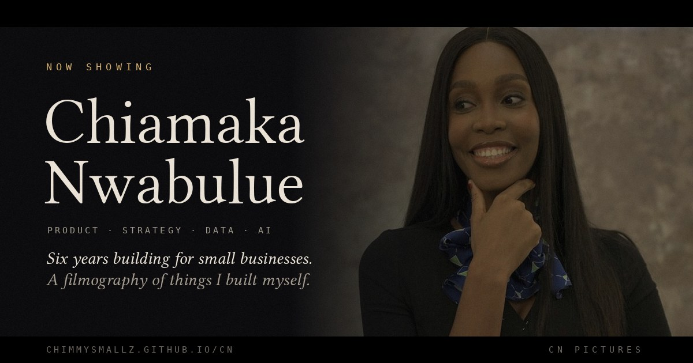

<div align="center">



# Chiamaka Nwabulue · Now Showing

**A personal profile that plays like a film.**

Product · Strategy · Data · AI

### [▶ Watch the film](https://chimmysmallz.github.io/CN/) · [⌘ Boot the OS](https://chimmysmallz.github.io/CN/os/)

</div>

---

## The idea

Most portfolio sites ask a visitor to read. This one asks them to sit down, dim the lights and press play.

It opens on a black screen with a studio ident, types out a short cold open, and cuts to a title card. Then it moves through three acts. Act I is six years in SME banking. Act II is a filmography of the products, games and stories I designed and built myself. Act III is a montage of the craft behind them. It ends with rolling credits and a post-credits scene that asks the visitor to cast me in the sequel.

Not everyone wants a film, so there is a second way in. **Chiamaka OS** is the same story told as a desktop operating system: a boot screen, draggable windows, case files, an arcade and a working terminal. Each version has a switch to the other.

Nothing on the page is a template. The film, the posters, the games in the intermission and every project in the filmography were designed and built by me.

---

## Contents

- [Two ways in](#two-ways-in)
- [How the film plays](#how-the-film-plays)
- [Features](#features)
- [Private premiere links](#private-premiere-links)
- [What is in this repository](#what-is-in-this-repository)
- [Run it locally](#run-it-locally)
- [Deploy on GitHub Pages](#deploy-on-github-pages)
- [Add the voice-over](#add-the-voice-over)
- [Visitor analytics](#visitor-analytics)
- [Editing the content](#editing-the-content)
- [Accessibility](#accessibility)
- [Privacy](#privacy)
- [Browser support](#browser-support)
- [Built with](#built-with)
- [Contact](#contact)

---

## Two ways in

| | The Film | Chiamaka OS |
|---|---|---|
| Address | [`/CN/`](https://chimmysmallz.github.io/CN/) | [`/CN/os/`](https://chimmysmallz.github.io/CN/os/) |
| Feels like | Sitting in a cinema | Using someone's laptop |
| Best for | A visitor with two minutes | A visitor who likes to explore and click around |
| How to switch | The **OS** button in the top corner, the link on the opening screen, the post-credits scene or the recruiter cut | **The Film.mov** on the desktop, the 🎬 in the dock, **Watch the film** in the menu bar, or type `film` in the terminal |

Switching plays a short old-television power-off effect, unless the visitor has accessible mode on. A [private premiere link](#private-premiere-links) keeps working across the switch, so `?for=Flutterwave` follows the visitor from one version to the other.

### Inside Chiamaka OS

| App | What it does |
|---|---|
| **About.app** | Who I am, with three personal numbers |
| **Case Files** | The day job (SME Hub, HerFidelity, the weekly SME Forum) and eleven things built after hours, each with a link where there is one |
| **Toolbox** | Skills shown as an activity monitor |
| **Arcade.app** | GemSlayer: Crystalwild, Mama Put: Buka Rush and Last Train from Hollow Pass, playable inside the window |
| **Reviews** | The four LinkedIn recommendations |
| **Terminal** | Type `help`. Commands include `whoami`, `work`, `projects`, `skills`, `games`, `reviews`, `film`, `hire` and `sudo hire chiamaka` |
| **Hire.me** | A message form that opens the visitor's own email |
| **Résumé** | Opens Hire.me with a résumé request ready to send |

---

## How the film plays

| # | Scene | What happens |
|---|---|---|
| 0 | **The gate** | A black screen rated "B for Builder". Visitors choose to play with sound, watch silently, take the 30-second recruiter cut, or (on phones) watch as Stories. They can also pick a look and switch on accessible mode here. |
| 1 | **Opening** | A "CN Pictures presents" ident with a gold light sweep, four typed lines, then a hard cut to the title card over a slow push-in on my portrait. |
| 2 | **Act I · The Day Job** | Six years in SME banking: what I lead, what I launched and what I learned. |
| 3 | **Interlude · By the Numbers** | Six personal numbers, one full screen at a time. Most of them count themselves from the page. |
| 4 | **Act II · Now Showing** | The filmography, laid out as movie posters with a genre, status, logline, link and a "Making of" commentary. |
| 5 | **The Critics** | Five-star extracts from LinkedIn recommendations, each linked to the person who wrote it. |
| 6 | **Intermission** | Sixty seconds on the clock. Visitors choose one of three of my games (GemSlayer: Crystalwild, Mama Put: Buka Rush or Last Train from Hollow Pass) and play it inside the page while the house lights come up. |
| 7 | **Act III · The Craft** | A scroll-driven montage through seven skills, followed by selected writing. |
| 8 | **End Credits** | A slow credit roll between running sprocket holes: skills, certifications, education and location. |
| 9 | **Post-Credits Scene** | "The sequel needs a cast." The roles I am open to, my contact details and the ticket booth. |
| 10 | **Fin.** | Look closely. There is a hidden scene. |

A visitor who scrolls straight through sees the whole film in about two minutes. The "Skip intro" button is visible from the first second.

---

## Features

### Cinema effects
- **Film grain, vignette and letterbox bars** that close in on every act card.
- **Hard cuts with a warm light leak** between scenes, and a projector flicker as each act title comes up.
- **A running timecode and scene name** in the corner, plus chapter navigation.
- **A synthesised score**: a low drone, hits, whooshes and a projector whirr during the credits. It is all generated in the browser, so the page loads no audio files. Sound only starts when the visitor chooses it.

### Story features
- **"Making of" commentary** on every poster: the problem, the hardest decision and what I would do next time.
- **"Previously on…" for returning visitors.** A second visit opens with "Welcome back · Episode 2" and a fast TV-style recap. Any title added since their last visit gets a gold "New this season" badge.
- **The late show.** The colour grade follows the visitor's local time: cooler at night, warmer in the morning. A line under my name follows Lagos time, for example *"It is 11:40 pm in Lagos. I am probably still building."*
- **Hover trailers.** On a laptop, the poster artwork moves like a short trailer when the cursor rests on it.
- **A "Coming Soon" slot** at the end of Act II for the next project.
- **A blooper reel.** Type `action` anywhere on the page, or tap **Fin.** in the footer.

### For busy visitors
- **The recruiter cut.** A one-screen summary: who I am, three highlights, the roles I want, a quote and my contact details.
- **Stories mode on phones.** The whole film as tap-through vertical slides. Tap right to go forward, tap left to go back, hold to pause.
- **The ticket booth.** The contact form issues an "ADMIT ONE" cinema ticket, then opens the visitor's own email app with the request ready to send.

### Looks and comfort
- **Four looks:** Noir (black and gold), Daylight (a light theme), Midnight (navy and blue) and Technicolor (near-black and red). The page remembers the choice, and devices set to light mode start in Daylight.
- **Accessible mode.** It removes all motion, raises contrast and makes text larger. See [Accessibility](#accessibility).

---

## Private premiere links

Add `?for=` and a company name to the end of the link:

```
https://chimmysmallz.github.io/CN/?for=Flutterwave
```

That visitor then sees:

- **On the gate:** "A private screening for the team at Flutterwave".
- **On the studio ident:** "CN Pictures presents… a private screening for the team at Flutterwave".
- **In the post-credits scene:** "The sequel could be filmed at Flutterwave."
- **In the recruiter cut:** "prepared for Flutterwave".
- **In the ticket booth:** the company field is already filled in.

Spaces work too: `?for=Acme Capital`. Names are cleaned and limited to 40 characters. Each company appears as its own event in the analytics, so I can see which tailored links were actually opened.

---

## What is in this repository

```
CN/
├── index.html                        The entire film: markup, styles, script and images
├── os/
│   └── index.html                    Chiamaka OS, the desktop version
├── og-poster.jpg                     1200 × 630 share image for LinkedIn, WhatsApp and X
├── games/
│   ├── gemslayer.html                GemSlayer: Crystalwild, neon match-three puzzle game
│   ├── mama-put-buka-rush.html       Mama Put: Buka Rush, cooking rush game
│   └── last-train-from-hollow-pass.html   Escape-room mystery game (intermission)
├── voice/                            Optional voice-over clips (see below)
│   ├── line1.mp3
│   ├── line2.mp3
│   ├── line3.mp3
│   └── line4.mp3
└── README.md
```

`index.html` is self-contained. All CSS, JavaScript and photographs are inline, and it uses no frameworks and no build step. The only outside request is the optional analytics script, which loads on the live site only.

---

## Run it locally

1. Download or clone the repository.
2. Open `index.html` in any modern browser.

The film plays fully from your computer. Two things behave differently offline:

- **The intermission games** need the `games` folder next to `index.html`. Some browsers block a game loaded inside a page opened straight from disk. If that happens, use **Open full screen**, or run a small local server:

  ```bash
  # from the repository folder
  python -m http.server 8000
  # then open http://localhost:8000
  ```

- **Analytics** only runs on the live `github.io` address, so local testing is never counted.

---

## Deploy on GitHub Pages

1. Push `index.html`, `og-poster.jpg`, and the `os` and `games` folders (and `voice`, if you have it) to the `main` branch.
2. Go to **Settings → Pages**.
3. Under **Build and deployment**, choose **Deploy from a branch**, then select `main` and `/ (root)`.
4. Save. The site goes live at `https://chimmysmallz.github.io/CN/` within a minute or two.

**After changing the share image:** LinkedIn keeps old previews for a while. Paste the address into the [LinkedIn Post Inspector](https://www.linkedin.com/post-inspector/) to refresh it.

---

## Add the voice-over

The cold open is designed to be read in my own voice. If no recording is present, the film simply plays without it.

1. Record each line as a separate clip. Read slowly, with a short pause at the start and the end.

   | File | Line |
   |---|---|
   | `line1.mp3` | Six years ago, I started meeting the people banks find hard to see. |
   | `line2.mp3` | Traders. Tailors. Women running three businesses from one phone. |
   | `line3.mp3` | I have spent every year since building for them. |
   | `line4.mp3` | And when the office closes, I keep building. |

2. Trim each clip and export it as MP3. [Audacity](https://www.audacityteam.org/) is free and does both.
3. Put the four files in a folder called `voice` and upload the folder to the repository.

When a visitor chooses **Play with sound**, each line plays as it types, the typing slows to match the voice, and the score dips underneath.

> **Recording tip:** a wardrobe full of clothes makes a surprisingly good recording booth.

---

## Visitor analytics

The site uses [GoatCounter](https://www.goatcounter.com/), which is free, needs no cookies and collects no personal data.

### Setup
1. Create a free GoatCounter account with the code **`chimmysmallz`**.
2. If that code is not available, open `index.html`, search for `GC_CODE` and replace `chimmysmallz` with your own code.

### What gets counted

| Area | Events |
|---|---|
| Opening | `play-with-sound`, `play-silent`, `intro-skipped-at-gate`, `intro-skipped-midway`, `intro-watched-to-end` |
| Returning visitors | `returning-visitor`, `previously-on-watched` |
| Premieres | `premiere-<company>`, for example `premiere-flutterwave` |
| Time of day | `mode-late`, `mode-matinee`, `mode-evening` |
| Looks and comfort | `theme-noir`, `theme-daylight`, `theme-midnight`, `theme-technicolor`, `accessible-on`, `accessible-off` |
| Scroll depth | `scroll-25`, `scroll-50`, `scroll-75`, `scroll-100` |
| Scenes reached | `reached-act1`, `reached-numbers`, `reached-act2`, `reached-reviews`, `reached-intermission`, `reached-act3`, `reached-credits`, `reached-post` |
| Posters | `making-of-<title>`, `open-<title>`, for example `making-of-vows-ng` and `open-shadow-vaults` |
| Intermission | `intermission-play-gemslayer`, `intermission-play-mama-put-buka-rush`, `intermission-play-last-train-from-hollow-pass`, `intermission-switch`, `intermission-one-more-minute`, `intermission-complete`, `intermission-skipped` |
| Recruiter cut | `open-recruiter`, `recruiter-email`, `recruiter-linkedin`, `recruiter-to-film` |
| Stories mode | `stories-open`, `stories-finished-at-<slide number>` |
| Contact | `ticket-issued`, `coming-soon-linkedin` |
| Easter egg | `easter-egg-typed`, `easter-egg-fin`, `open-bloopers` |
| Switching | `switch-to-os` (from the film), `os-switch-to-film` (from the OS) |
| Chiamaka OS | Every OS event starts with `os-`: `os-open-<app>`, `os-cmd-<command>`, `os-arcade-<game>`, `os-hire-send`, `os-resume-request`, `os-premiere-<company>` |

**The question this answers:** how long should the opening be? If `intro-skipped-midway` is high and `intro-watched-to-end` is low, the cold open is too long.

---

## Editing the content

Everything lives in `index.html`. Open it in [VS Code](https://code.visualstudio.com/) and use **Find** (`Ctrl + F`) to jump to the parts below.

| To change… | Search for | Notes |
|---|---|---|
| The four typed opening lines | `var LINES=` | If you record a voice-over, keep the clips in the same order. |
| The title card tagline | `class="tag"` | The line under my name. |
| The Lagos time lines | `in Lagos.` | Four lines, one for each part of the day. |
| Act I text and roles | `id="dayjob"` | The story and the two roles. |
| The interlude numbers | `class="beat"` | `data-n="6"` is a fixed number. `data-n="auto:films"` counts the posters by itself. |
| A poster | `class="poster rv"` | Each poster is one `<article>`. The filter tags are in `data-k` (`product`, `play`, `story`). Add `data-live="1"` if the project has a live link. |
| A poster's "Making of" | `class="mkp"` | Three short entries: the problem, the hardest decision, next time. |
| The Coming Soon slot | `class="poster soon` | Replace it with the real poster when the project launches. |
| Reviews | `id="reviews"` | Quote recommenders word for word, and link each name to their profile. |
| The montage | `var SHOTS=` | Each shot is a word, a caption and a line of tools. |
| Selected writing | `id="articles"` | One link per article. The article count updates by itself. |
| Credits | `id="credits"` | Certifications live inside `id="certs"`. The certification count updates by itself. |
| Recruiter cut | `id="recruiter"` | The summary, three highlights and the quote. |
| Blooper reel | `id="bloopers"` | Each take is one `class="take"` block. |
| Contact details | `chidexnwabulue@gmail.com` | Appears in the recruiter cut, the post-credits scene and the ticket booth. |
| Intermission games | `var GAMES=` | Add a game card in `id="imPick"`, an entry in `GAMES`, and the file in `games/`. |
| Anything in Chiamaka OS | `os/index.html` | Each app is one `<section class="win">`. Terminal commands live in `var C={`. |

### Adding a new project
1. Copy an existing poster `<article>` and update the genre, title, logline, status and link. Add it to the Case Files in `os/index.html` as well, and update the `projects` terminal command.
2. Add its "Making of" notes.
3. Save and publish. Returning visitors automatically see it marked **New this season**, and the interlude, recruiter cut and Stories mode all update their counts.

### Changing a photograph
Photographs are stored inside the file as `data:image/jpeg;base64,…` text, so the page needs no image folder. To swap one, convert the new image at a site such as [base64-image.de](https://www.base64-image.de/) and replace the long text after `src="` for that image. Keep images under about 150 KB, so the page stays fast on mobile data.

---

## Accessibility

The film is designed to be enjoyed by everyone, not just those who can watch it move.

- **Accessible mode** (on the gate or the "Accessible" button in the corner):
  - removes every animation, the grain, flicker, light leaks and letterbox bars
  - lays the montage and credits out as plain, readable sections
  - raises contrast in all four looks, enlarges the text and widens the line spacing
  - underlines links and strengthens the keyboard focus outline
  - slows Stories mode to 15 seconds per slide
- **Reduced motion is respected automatically.** Visitors whose device asks for reduced motion get the motion-free version without touching anything.
- **Sound never plays on its own.** The visitor has to choose it.
- **Keyboard support:** every control is a real button or link. `Esc` closes overlays, and the arrow keys move through Stories mode.
- **A skip link** jumps straight to the content.
- **Every photograph has alternative text**, and the chapter navigation, dialogs and toggles are labelled for screen readers.

---

## Privacy

- **No cookies, no sign-in, no forms sent to a server.** The ticket booth opens the visitor's own email app. Nothing is stored remotely.
- **The page remembers a few settings on the visitor's own device**, in the browser's local storage:

  | Key | What it holds |
  |---|---|
  | `cn_theme` | The chosen look |
  | `cn_a11y` | Whether accessible mode is on |
  | `cn_film_v1` | The visit count and the list of titles seen, for "Previously on…" and "New this season" |
  | `cn_channel` | Whether the visitor was last in the film or the OS |

  Chiamaka OS reads `cn_a11y` too, so accessible mode in the film also turns off motion in the OS.

  Clearing the browser's site data resets all of them.
- **Analytics** are anonymous page and event counts from GoatCounter, loaded only on the live site.

---

## Browser support

Built for current versions of Chrome, Edge, Firefox and Safari on desktop, and Chrome and Safari on Android and iOS.

- Stories mode appears on screens narrower than 760 pixels.
- Hover trailers appear only on devices with a mouse or trackpad.
- Older browsers without the Web Audio API still play the film, just without the score.

---

## Built with

- **Plain HTML, CSS and JavaScript.** No frameworks, no libraries and no build step.
- **The Web Audio API** for the synthesised score and sound effects.
- **Canvas** for the live film grain.
- **IntersectionObserver** for scene reveals, the credit roll and scroll tracking.
- **GoatCounter** for privacy-friendly analytics.

The intermission games, GemSlayer: Crystalwild, Mama Put: Buka Rush and Last Train from Hollow Pass, are my own single-file browser games.

---

## Contact

The sequel needs a cast. I am open to Product, Strategy & Operations, Business Operations, Chief of Staff and AI-enabled Product roles, with remote-first and international teams.

- **LinkedIn:** [linkedin.com/in/chiamaka-nwabulue](https://www.linkedin.com/in/chiamaka-nwabulue/)
- **Email:** [chidexnwabulue@gmail.com](mailto:chidexnwabulue@gmail.com)
- **The film:** [chimmysmallz.github.io/CN](https://chimmysmallz.github.io/CN/)

---

<div align="center">

**Fin.**

© 2026 Chiamaka Nwabulue · All rights reserved.
The code, writing, artwork and games in this repository are my own work and may not be reused without permission.

</div>
